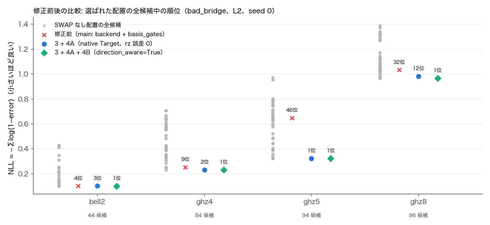
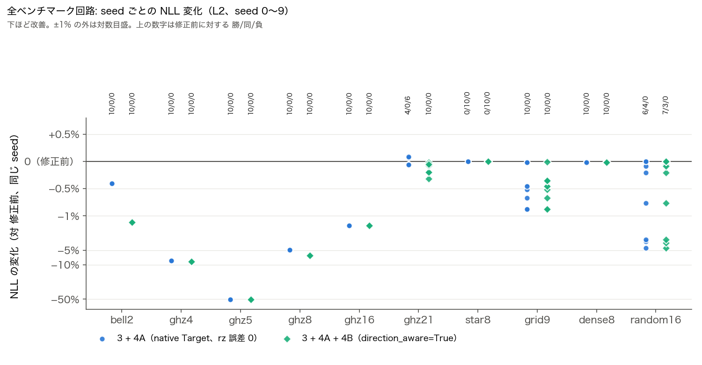

# 校正値保持・CX 向き考慮のベンチマーク

`ref/issues/ISSUES.md` の「3. 解決案（問題2）」と「4. 解決案（問題1）の A と B」を Tranqu の Qiskit transpiler に入れ、修正前（`main`）と修正後を比べる。

## 修正内容

| ISSUES | 修正 | 場所 |
|---|---|---|
| 3 | device と `basis_gates` が同時に指定されたとき、`backend=` + `basis_gates=` ではなく、device の Target を basis gates に絞り、校正値（InstructionProperties）を残した Target を `target=` で渡す。Target を作り直させるオプション（`coupling_map`・`dt` など）があるときは従来どおり | `QiskitTranspiler._set_device`、`qiskit_target_builder.build_native_target` |
| 4A | rz は仮想ゲートなので、converter で error 0・duration 0 にする | `OqtoqusToQiskitDeviceConverter` |
| 4B | `transpiler_options` に `direction_aware=True` を指定すると、逆向き CX を「CX + 各量子ビットに sx×2」の誤差で許す計画用 Target で layout・routing・translation を行い、向きを厳密に区別する `VF2PostLayout` で配置を選び直してから、本物の一方向 Target で translation 以降をやり直す | `qiskit_target_builder.transpile_direction_aware` |

使い方（3 と 4A は既存の呼び出しのままで有効になる。4B はオプション）:

```python
tranqu.transpile(program=qc, program_lib="qiskit", transpiler_lib="qiskit",
                 transpiler_options=dict(basis_gates=["rz", "sx", "cx", "measure"],
                                         optimization_level=2, direction_aware=True),
                 device=device_json, device_lib="oqtopus")
```

ISSUES の試作（`ref/issues/direction_aware.py`）との違い: Qiskit 2.2.3 の向き厳密な `VF2PostLayout` は、入力回路が Target のゲートで書かれていないと解なし（`NO_SOLUTION_FOUND`）を返す。routing 直後の回路には `h` などが残るため、計画用 Target での translation の後（`post_translation`）に実行している。Qiskit 2.4.2 ではこの制約はない。

## 再現

```sh
# 修正前: main の worktree で
git worktree add ../tranqu-main main && (cd ../tranqu-main && uv sync)
(cd ../tranqu-main && uv run python $PWD/benchmarks/calibration_direction/bench.py \
    --configs basis,basis_legacy --out $PWD/benchmarks/calibration_direction/results_before.json)
# 修正後
uv run python benchmarks/calibration_direction/bench.py \
    --configs basis,basis_da,basis_legacy,basis_legacy_da --out benchmarks/calibration_direction/results_after.json
uv run python benchmarks/calibration_direction/compare.py \
    benchmarks/calibration_direction/results_before.json benchmarks/calibration_direction/results_after.json \
    --md benchmarks/calibration_direction/RESULTS.md
```

- デバイス: `bad_bridge.json`（21 量子ビット、一方向 CX 22 本、橋 11→9 の fidelity を 0.70 に下げた版）
- 回路: bell2, ghz4/5/8/16/21, star8, grid9, dense8, random16（`measure_all` 付き）、`optimization_level=2`、seed 0〜9
- 構成: `basis` = `basis_gates=["rz","sx","cx","measure"]`、`basis_legacy` = `["id","sx","x","rz","cx"]`、`_da` = `direction_aware=True` を追加
- 指標は Target ではなく JSON から直接計算する（両ブランチで同じ尺度にするため）。NLL = Σ −log(1−error)（rz は 0、測定を含む）、実行時間 = JSON の duration（CX = RZX90×2）によるクリティカルパス

全数値は [RESULTS.md](RESULTS.md)。

## 結果

図は `uv run --with matplotlib python benchmarks/calibration_direction/plot.py results_before.json results_after.json`（修正後のブランチで実行）で再生成できる。

### SWAP 不要の回路: 選ばれた配置の全候補中の順位（seed 0）



灰色の点は、SWAP なしで置ける全配置（単純経路 × 向き）を `initial_layout` 固定で変換した NLL。3+4A+4B は 4 回路すべてで全候補中 1 位の配置を選ぶ。3+4A は bell2・ghz4・ghz8 で 1 位を逃す（配置は良いが CX の向きが逆）。修正前の順位は ISSUES の fig7 と異なる（Qiskit のバージョン差、下記）。

### 全ベンチマーク回路: seed ごとの NLL 変化（対 修正前）



0 より下が改善。3+4A は ghz21 で 6 seed 悪化するが、3+4A+4B は全回路・全 seed で修正前と同じか良い。

### 平均値（`basis`、10 seed）

| 回路 | NLL 修正前 → 3+4A → 3+4A+4B | sx+x 修正前 / 3+4A / +4B | 実行時間 [ns] 修正前 → +4B | +4B の勝/同/負（対 修正前） | +4B の勝/同/負（対 3+4A） |
|---|---:|---:|---:|---:|---:|
| bell2 | 0.1022 → 0.1018 → 0.1009 | 3.0 / 3.0 / 1.0 | 320 → 272 | 10/0/0 | 10/0/0 |
| ghz4 | 0.2521 → 0.2316 → 0.2305 | 5.0 / 7.0 / 5.0 | 1008 → 1008 | 10/0/0 | 10/0/0 |
| ghz5 | 0.6482 → 0.3222 → 0.3222 | 9.0 / 9.0 / 9.0 | 1328 → 1296 | 10/0/0 | 0/10/0 |
| ghz8 | 1.0331 → 0.9821 → 0.9674 | 13.0 / 15.0 / 13.0 | 2192 → 2096 | 10/0/0 | 10/0/0 |
| ghz16 | 2.4673 → 2.4285 → 2.4285 | 29.0 / 29.0 / 29.0 | 4880 → 4944 | 10/0/0 | 0/10/0 |
| ghz21 | 3.6449 → 3.6459 → 3.6404 | 60.6 / 58.4 / 58.4 | 9720 → 9717 | 10/0/0 | 10/0/0 |
| star8 | 4.2540 → 4.2540 → 4.2540 | 96.2 / 96.2 / 96.2 | 11790 → 11790 | 0/10/0 | 0/10/0 |
| grid9 | 8.7738 → 8.7421 → 8.7322 | 155.2 / 153.9 / 153.9 | 15189 → 15058 | 10/0/0 | 3/7/0 |
| dense8 | 17.0470 → 17.0440 → 17.0440 | 323.4 / 317.7 / 317.7 | 49299 → 49259 | 10/0/0 | 0/10/0 |
| random16 | 6.5702 → 6.4923 → 6.4907 | 153.1 / 153.0 / 153.0 | 6307 → 6318 | 7/3/0 | 2/8/0 |

- **修正前に対し、3+4A+4B は 100 実行中 87 勝・13 分・0 敗**。3+4A だけでは 80 勝・14 分・6 敗（ghz21 で 6 seed 悪化、ISSUES 2 章と同じ現象）だが、4B を足すと ghz21 も全 seed で修正前より良くなる。
- **4B の上乗せ（対 3+4A）は 45 勝・55 分・0 敗**。SWAP 不要の bell2・ghz4・ghz8 では逆向き CX が 1 本減り、sx+x が 2 減る（bell2 は [9,10] → [10,9]、ISSUES 5.1 と同じ配置）。
- 3 の効果: 「invalidate the backend's gate durations and error rates」警告が 100 件 → 0 件。bell2・ghz4・ghz5・ghz8 の配置が校正値の良い領域（q9・q10 付近）に移る。
- 全構成で、出力ゲートは basis の範囲内、CX は全て登録方向（逆向き CX 0）。
- 1 回あたりの変換時間は 13 ms → 4B ありで 16 ms（約 +20%）。
- `basis_legacy`（`id`・`x` を含む現状の basis）でも傾向は同じ（[RESULTS.md](RESULTS.md)）。

### ISSUES.md の数値との違い

修正前（`main`）の数値は ISSUES.md の「現状」と一致しない（例: bell2 は ISSUES で NLL 0.161、ここでは 0.1022）。ISSUES は Qiskit 2.4.2、このリポジトリは Qiskit 2.2.3 で、校正値を失ったときの配置の決まり方がバージョンで違うため。修正後の値（3+4A+4B）は ISSUES 5 章とほぼ一致する（bell2 0.101、ghz4 0.231、ghz5 0.322、ghz8 0.967、ghz16 2.429）。

### 限界

NLL は独立誤差を仮定した参考値で、実機の成功確率ではない。実行時間は CX = RZX90×2 の仮定による見積もり。校正 snapshot は 1 つ、seed は 0〜9。「逆向き CX」は Qiskit が H で挟んで直した後の出力で数えているので常に 0。向きの補正の量は sx+x の差で見ている。
