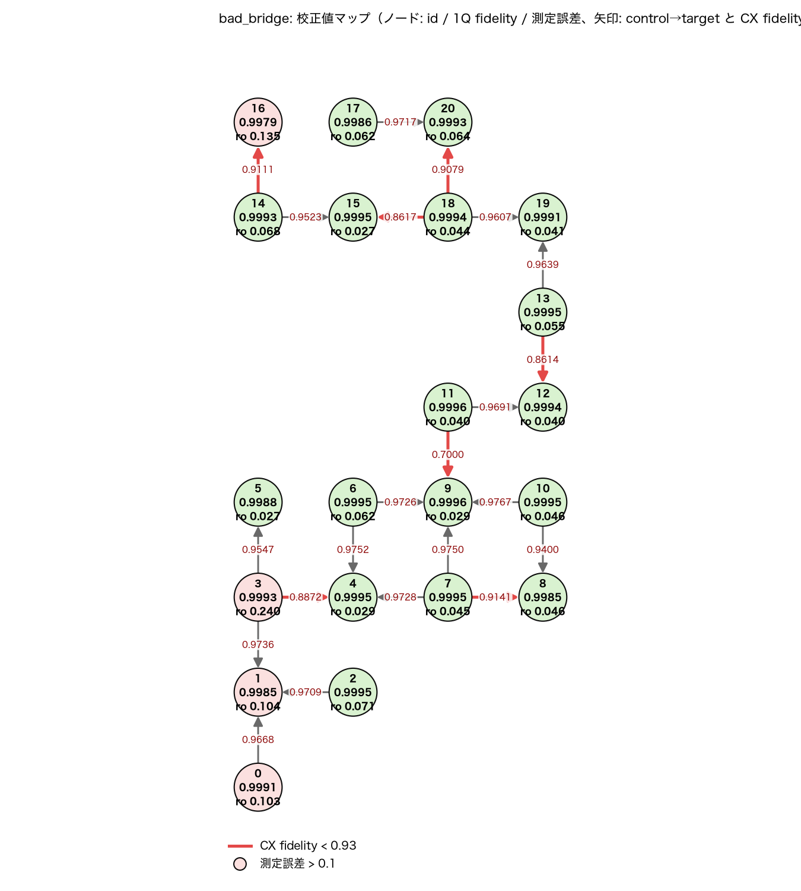
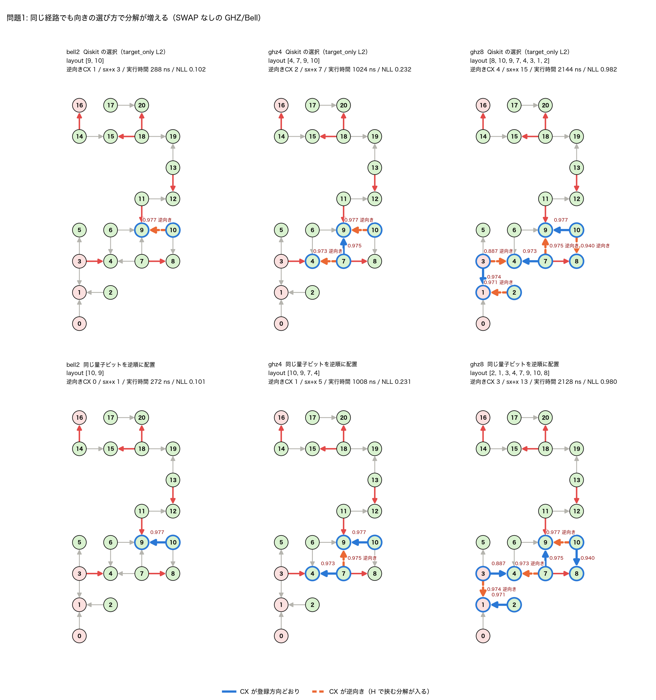
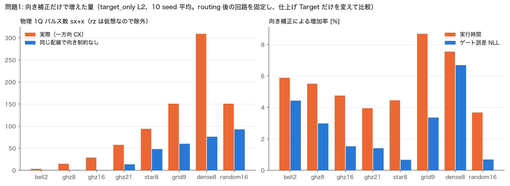
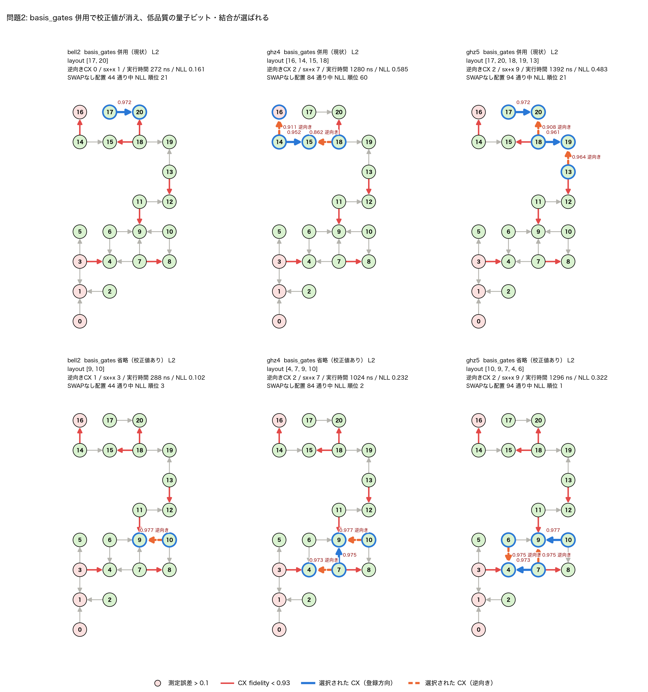
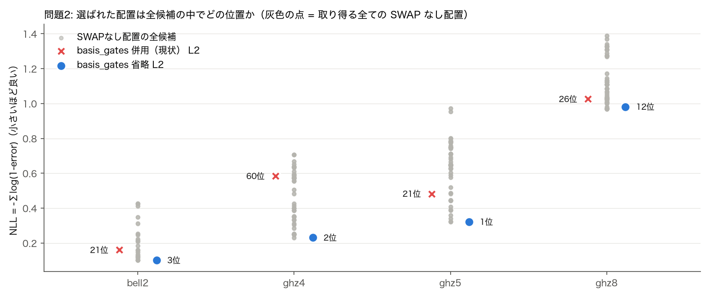
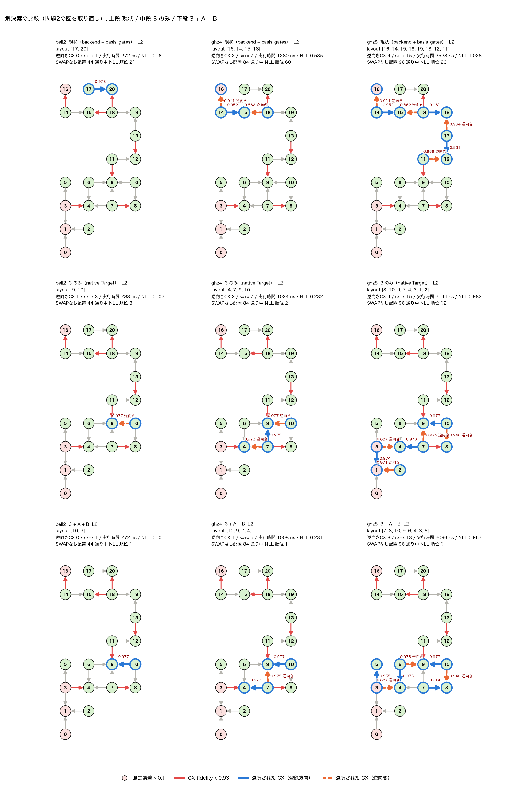
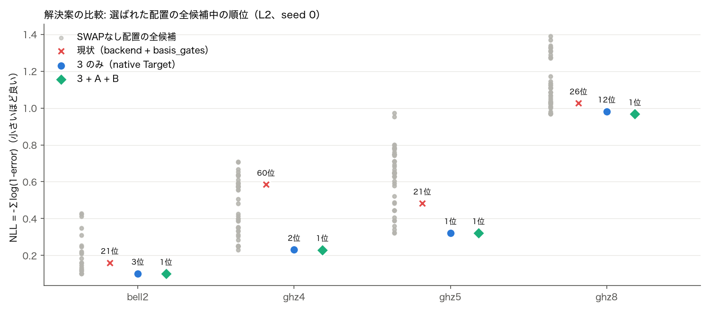
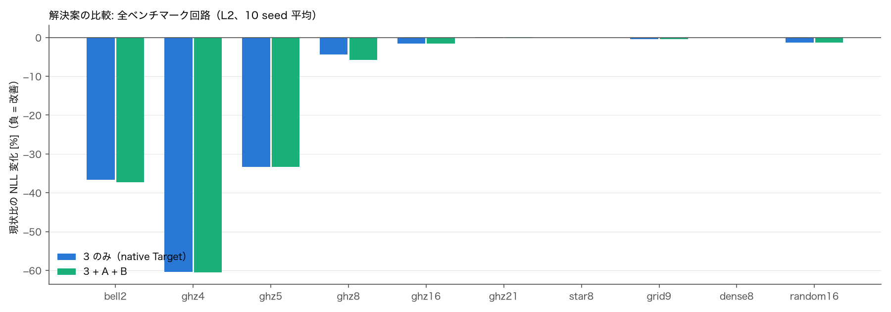

# トランスパイラの2つの問題の見える化（bad_bridge トポロジー）

対象: `topologies/bad_bridge.json`（21量子ビット・有向 CX 22本の歯抜け格子。橋 11→9 の fidelity を .70 に下げた版）。Qiskit 2.4.2 / Tranqu の converter で Target を作成。transpile の呼び方は Tranqu と同じ（`backend=` を渡す）。再現: `.venv/bin/python issues/visualize_issues.py`。数値は `issues/results.json`。

- **default**: `t.py` と同じく `basis_gates=[id,sx,x,rz,cx]` を併用（現状）
- **target_only**: `basis_gates` を省略し、Tranqu が作った Target（校正値つき）をそのまま使う

## 0. 校正値マップ（ref/device.py 形式）



ノードは `id / 1Q fidelity / 測定誤差`（Tranqu converter と同じ (P(1|0)+P(0|1))/2）、矢印は control→target と CX fidelity。赤は CX fidelity < 0.93（3→4 (0.887), 7→8 (0.914), 11→9 (0.700), 13→12 (0.861), 14→16 (0.911), 18→15 (0.862), 18→20 (0.908)）、ピンクのノードは測定誤差 > 0.1（q0 (0.103), q1 (0.104), q3 (0.240), q16 (0.135)）。全結合が一方向だけ登録されており、隣り合う辺の向きが揃っていないため、鎖状の回路は向きの選び方次第で逆向き CX が生じる。

## 1. 問題1: CX の向き

前提: **device-gateway は登録方向の CX しか実行できない**。逆向きの CX は native CX の両側を H で挟んで実行するしかない。H は rz・sx・rz に分解され、rz は仮想ゲート（JSON の duration 0）なので、物理的に増えるのは sx パルスだけである。以下ではコストを **sx+x のパルス数、実行時間、ゲート誤差（rz と測定を除く NLL）** で測る。実行時間は JSON の duration（sx 16 ns、x 24 ns、rz 0）と、CX = RZX90×2 という仮定で計算した。

> 旧版はコストを「1Q ゲート数（rz を含む）と depth（時間の重みなし）」で測っており、ghz8 で「1Q 3→41、depth 11→29」と過大に見えていた。物理指標では下記のとおり小さい。

### 1.1 原因の切り分け（SWAP 不要の回路）

SWAP が要らない GHZ/Bell は、配置＝グラフ上の単純経路と向きの選択だけで決まる。全候補を列挙し（`initial_layout` 固定で変換）、Qiskit の選択、「同じ量子ビットを逆順に置いた配置」、全候補での逆向き CX の最小値を比べた。

| 回路 | 条件 | Qiskit の layout | 逆向き CX | sx+x | 実行時間 [ns] | NLL | → 逆順 layout | 逆向き CX | sx+x | 実行時間 [ns] | NLL | 全候補の最小逆向き数 |
|---|---|---|---:|---:|---:|---:|---|---:|---:|---:|---:|---:|
| bell2 | default L2 | [17,20] | 0 | 1 | 272 | 0.161 | [20,17] | 1 | 3 | 288 | 0.163 | 0 |
| bell2 | target_only L2 | [9,10] | 1 | 3 | 288 | 0.102 | [10,9] **◀** | 0 | 1 | 272 | 0.101 | 0 |
| bell2 | target_only L3 | [9,10] | 1 | 3 | 288 | 0.102 | [10,9] **◀** | 0 | 1 | 272 | 0.101 | 0 |
| ghz4 | default L2 | [16,14,15,18] | 2 | 7 | 1280 | 0.585 | [18,15,14,16] **◀** | 1 | 5 | 1264 | 0.582 | 1 |
| ghz4 | target_only L2 | [4,7,9,10] | 2 | 7 | 1024 | 0.232 | [10,9,7,4] **◀** | 1 | 5 | 1008 | 0.231 | 1 |
| ghz4 | target_only L3 | [4,7,9,10] | 2 | 7 | 1024 | 0.232 | [10,9,7,4] **◀** | 1 | 5 | 1008 | 0.231 | 1 |
| ghz5 | default L2 | [17,20,18,19,13] | 2 | 9 | 1392 | 0.483 | [13,19,18,20,17] | 2 | 9 | 1392 | 0.484 | 2 |
| ghz5 | target_only L2 | [10,9,7,4,6] | 2 | 9 | 1296 | 0.322 | [6,4,7,9,10] | 2 | 9 | 1296 | 0.322 | 2 |
| ghz5 | target_only L3 | [10,9,7,4,6] | 2 | 9 | 1296 | 0.322 | [6,4,7,9,10] | 2 | 9 | 1296 | 0.322 | 2 |
| ghz8 | default L2 | [16,14,15,18,19,13,12,11] | 4 | 15 | 2528 | 1.026 | [11,12,13,19,18,15,14,16] **◀** | 3 | 13 | 2512 | 1.024 | 3 |
| ghz8 | target_only L2 | [8,10,9,7,4,3,1,2] | 4 | 15 | 2144 | 0.982 | [2,1,3,4,7,9,10,8] **◀** | 3 | 13 | 2128 | 0.980 | 3 |
| ghz8 | target_only L3 | [12,11,9,10,8,7,4,6] | 4 | 15 | 2176 | 0.970 | [6,4,7,8,10,9,11,12] **◀** | 3 | 13 | 2160 | 0.969 | 3 |

**◀** = 同じ量子ビット・同じ結合のまま、並びを逆にするだけで逆向き CX が減る。L3 は参考（`strict_direction=True` の VF2PostLayout が最適化段にある唯一のレベル）で、L3 でも改善しない。target_only L2 は bell2・ghz4・ghz8 で最小値より多く、ghz5 は最小値に一致。



追加コストは2つに分かれる。

- **(a) 配置で避けられる分**: Qiskit が結合を無向として配置を決めるため（下記のソース根拠）。Qiskit の選択と最小値との差。bell2（target_only L2）は校正値を見て最良の辺 10→9 を選ぶが、論理 CX を 9→10 の向きで置くので逆向きが1本生じる。**校正値を有効にすると、かえってこの問題が表面化する**。
- **(b) どう配置しても避けられない分**: このトポロジーは隣接辺の向きが交互に並ぶため、最小値（ghz8 で3本）より減らせない。一方向の結合上の SWAP も、必ず逆向き CX を1本含む。

### 1.2 向き補正の物理コスト（SWAP を含む全ベンチマーク回路）

Qiskit の routing 直後の回路を取り出し、(1) 実際の一方向 Target、(2) 同じ校正値で両方向を許した Target で、後段（translation/optimization）だけを実行して差を取った。配置と SWAP は同じなので、差は向き補正だけに起因する。(1) は通常の transpile 出力と全実行で一致を確認済み。10 seed 平均。

| 回路 | 条件 | 論理CX+SWAP | 逆向き CX（SWAP 除く） | sx+x 一方向 ← 両方向 | 実行時間 [ns] 一方向 ← 両方向 | ゲート誤差 NLL 一方向 ← 両方向 |
|---|---|---|---:|---:|---:|---:|
| bell2 | default L2 | CX 1 + SWAP 0.0 | 0.0 | 1.0 ← 1.0 | 272 ← 272（+0%） | 0.030 ← 0.030（+0%） |
| bell2 | target_only L2 | CX 1 + SWAP 0.0 | 1.0 | 3.0 ← 1.0 | 288 ← 272（+6%） | 0.025 ← 0.024（+4%） |
| ghz8 | default L2 | CX 7 + SWAP 0.0 | 4.0 | 15.0 ← 1.0 | 2528 ← 2416（+5%） | 0.559 ← 0.550（+2%） |
| ghz8 | target_only L2 | CX 7 + SWAP 0.0 | 4.0 | 15.0 ← 1.0 | 2144 ← 2032（+6%） | 0.325 ← 0.316（+3%） |
| ghz16 | default L2 | CX 15 + SWAP 0.0 | 7.0 | 29.0 ← 1.0 | 4880 ← 4656（+5%） | 1.308 ← 1.289（+2%） |
| ghz16 | target_only L2 | CX 15 + SWAP 0.0 | 7.0 | 29.0 ← 1.0 | 4944 ← 4720（+5%） | 1.304 ← 1.284（+2%） |
| ghz21 | default L2 | CX 20 + SWAP 5.1 | 10.0 | 57.6 ← 13.0 | 9721 ← 9354（+4%） | 2.186 ← 2.157（+1%） |
| ghz21 | target_only L2 | CX 20 + SWAP 5.1 | 10.0 | 57.6 ← 13.5 | 9670 ← 9302（+4%） | 2.190 ← 2.160（+1%） |
| star8 | default L2 | CX 21 + SWAP 10.1 | 9.7 | 94.2 ← 48.0 | 11774 ← 11274（+4%） | 3.674 ← 3.650（+1%） |
| star8 | target_only L2 | CX 21 + SWAP 10.1 | 9.7 | 94.2 ← 48.0 | 11774 ← 11274（+4%） | 3.674 ← 3.650（+1%） |
| grid9 | default L2 | CX 36 + SWAP 16.1 | 17.6 | 150.9 ← 59.9 | 15175 ← 13973（+9%） | 8.165 ← 7.905（+3%） |
| grid9 | target_only L2 | CX 36 + SWAP 16.1 | 17.6 | 150.9 ← 59.9 | 15060 ← 13858（+9%） | 8.049 ← 7.789（+3%） |
| dense8 | default L2 | CX 84 + SWAP 47.8 | 38.8 | 309.1 ← 75.8 | 49250 ← 45791（+8%） | 16.461 ← 15.429（+7%） |
| dense8 | target_only L2 | CX 84 + SWAP 47.8 | 38.8 | 309.1 ← 75.8 | 49250 ← 45791（+8%） | 16.461 ← 15.429（+7%） |
| random16 | default L2 | CX 24 + SWAP 14.1 | 11.7 | 151.0 ← 92.6 | 6308 ← 6087（+4%） | 5.516 ← 5.478（+1%） |
| random16 | target_only L2 | CX 24 + SWAP 14.1 | 11.7 | 151.0 ← 92.6 | 6321 ← 6097（+4%） | 5.432 ← 5.394（+1%） |



sx パルスは数倍に増えるが、sx は CX に比べて短く誤差も小さい（約 5e-4 対 約 3%）。そのため、実行時間の増加は 4〜9%、ゲート誤差の増加は 1〜7% にとどまる（bell2 を除く、target_only L2）。**問題1は実在するが、CX 数・SWAP 数（routing の質）や問題2に比べると影響は小さい。**

### ソース上の根拠（Gemini による調査を grep で確認）

- `qiskit/transpiler/passes/layout/sabre_layout.py:172,188` — SabreLayout は `coupling_map.make_symmetric()` で結合を無向化。SabreSwap も無向の距離で SWAP を選ぶ。
- `qiskit/transpiler/preset_passmanagers/common.py:364-370` — level 1/2 の routing 段の VF2PostLayout は `strict_direction=False`（向きを区別せずに採点）。
- `qiskit/transpiler/preset_passmanagers/builtin_plugins.py:570-576` — `strict_direction=True` の VF2PostLayout は level 3 の最適化段だけ。
- `qiskit/transpiler/preset_passmanagers/common.py:559-572` — 向きは translation 段の `CheckGateDirection` → `GateDirection` で、逆向き CX を H で挟んで直すだけ。


## 2. 問題2: エラー率が無視される

default では Qiskit が次の警告を出す: `Providing `coupling_map` and/or `basis_gates` along with `backend` is not recommended, as this will invalidate the backend's gate durations and error rates.`。`generate_preset_pass_manager.py:211-220` で警告を出し、`:254` で `Target.from_configuration(basis_gates=..., coupling_map=...)` により Target を作り直す。`target.py` の `from_configuration` は error を設定しないため、InstructionProperties.error は全て `None` になる（Tranqu `qiskit_transpiler.py:44-48` は options をそのまま渡す）。このため VF2Layout / VF2PostLayout の誤差による採点が働かず、量子ビット番号や探索順だけで配置が決まる。

### 割り出したケース（SWAP 不要の回路、L2）

| 回路 | 条件 | layout | 使った低品質要素 | NLL | 全候補中の順位 | 最良候補 (NLL) |
|---|---|---|---|---:|---:|---|
| bell2 | default | [17,20] | — | 0.161 | 21/44 | [10,9] (0.101) |
| bell2 | target_only | [9,10] | — | 0.102 | 3/44 | [10,9] (0.101) |
| ghz4 | default | [16,14,15,18] | q16(ro 0.135), 14→16(0.911), 18→15(0.862) | 0.585 | 60/84 | [10,9,7,4] (0.231) |
| ghz4 | target_only | [4,7,9,10] | — | 0.232 | 2/84 | [10,9,7,4] (0.231) |
| ghz5 | default | [17,20,18,19,13] | 18→20(0.908) | 0.483 | 21/94 | [10,9,7,4,6] (0.322) |
| ghz5 | target_only | [10,9,7,4,6] | — | 0.322 | 1/94 | [10,9,7,4,6] (0.322) |
| ghz8 | default | [16,14,15,18,19,13,12,11] | q16(ro 0.135), 14→16(0.911), 18→15(0.862), 13→12(0.861) | 1.026 | 26/96 | [7,8,10,9,6,4,3,5] (0.967) |
| ghz8 | target_only | [8,10,9,7,4,3,1,2] | q3(ro 0.240), q1(ro 0.104), 3→4(0.887) | 0.982 | 12/96 | [7,8,10,9,6,4,3,5] (0.967) |





- **ghz4（default）** は [16,14,15,18] を選び、q16（測定誤差 0.135）、14→16（fidelity 0.911）、18→15（fidelity 0.862） を使う。NLL 0.585、84 候補中 60 位。校正値を残すと [4,7,9,10]（NLL 0.232、2 位）。
- **bell2（default）** は L1 で番号順の [0,1]（q0（測定誤差 0.103）、q1（測定誤差 0.104）、NLL 0.253・33位）、L2 で [17,20]（21位）。校正値の差ではなく探索の都合で決まっている。
- target_only は ghz4/ghz5 でほぼ最良を選ぶが、bell2・ghz4 では問題1の向きの不利を抱えたまま。2つの問題は別々に直す必要がある（4章）。

### SWAP を含む全ベンチマーク回路（L2、10 seed）

同じ seed の default と target_only の NLL（rz を誤差0として採点、測定を含む）を比較。8量子ビット以上の回路は低品質要素（測定誤差 > .1 の q0/q1/q3/q16、CX fidelity < .93 の7本）を両モードとも全 seed で通過しており、避けきれない。target_only は bell2・ghz8・ghz16 で全 seed 改善、grid9・random16 で大半の seed が改善、star8・dense8 で差なし、**悪化: ghz21（7/10 seed）**。悪化するのは全21量子ビットを使う ghz21 で、配置の自由度がほぼ無い（原因は未調査）。校正値を戻すことは必要だが、それだけで常に良くなるわけではない。

| 回路 | 平均 NLL default → target_only | target_only の 勝/同/負 |
|---|---:|---:|
| bell2 | 0.161 → 0.102 | 10/0/0 |
| ghz8 | 1.026 → 0.982 | 10/0/0 |
| ghz16 | 2.467 → 2.429 | 10/0/0 |
| ghz21 | 3.641 → 3.645 | 0/3/7 |
| star8 | 4.253 → 4.253 | 0/10/0 |
| grid9 | 8.772 → 8.731 | 9/1/0 |
| dense8 | 17.040 → 17.040 | 0/10/0 |
| random16 | 6.573 → 6.491 | 6/4/0 |
## 3. 解決案（問題2）: native ゲートを指定しつつ校正値を残す

native ゲートを指定して分解したい場合も、`basis_gates` は使わない。**native ゲートだけを残し、校正値（InstructionProperties）をコピーした Target を作り、`target=` で渡す。**
Qiskit は `target` が与えられると `backend`・`basis_gates` から Target を作り直さない（`generate_preset_pass_manager.py:243-246`）。そのため error が残り、警告も出ない。

```python
from qiskit.transpiler import Target

def native_target(target, names):
    """native ゲートだけを残し、InstructionProperties（error/duration）をそのままコピーする。"""
    t = Target(num_qubits=target.num_qubits, dt=target.dt)
    for name in names:
        t.add_instruction(target.operation_from_name(name), dict(target[name]))
    return t

backend = OqtoqusToQiskitDeviceConverter().convert(device_json)
nt = native_target(backend.target, ["rz", "sx", "cx", "measure"])

# Tranqu 経由: options に target を入れる（Tranqu が追加する backend より target が優先される）
tranqu.transpile(program=qc, program_lib="qiskit", transpiler_lib="qiskit",
                 transpiler_options=dict(target=nt, optimization_level=2),
                 device=device_json, device_lib="oqtopus")
```

### bad_bridge での確認（L2、10 seed）

native = `['rz', 'sx', 'cx', 'measure']`（x を除いた例）。`target=` 直指定と Tranqu 経由（`transpiler_options=dict(target=nt, ...)` ＋ `device=`）は全実行で layout・ゲート数が一致。警告は 0 件、出力ゲートは全て native の範囲内。比較対象は同じ native を `basis_gates` で指定した現状の方法。

| 回路 | layout（seed 0）basis_gates | layout（seed 0）native Target | 平均 NLL basis_gates → native Target | native Target の 勝/同/負 |
|---|---|---|---:|---:|
| bell2 | [17,20] | [9,10] | 0.161 → 0.102 | 10/0/0 |
| ghz4 | [16,14,15,18] | [4,7,9,10] | 0.585 → 0.232 | 10/0/0 |
| ghz5 | [17,20,18,19,13] | [10,9,7,4,6] | 0.483 → 0.322 | 10/0/0 |
| ghz8 | [16,14,15,18,19,13,12,11] | [8,10,9,7,4,3,1,2] | 1.026 → 0.982 | 10/0/0 |
| ghz16 | [0,1,3,4,7,8,10,9,11,12,13,19,18,15,14,16] | [2,1,3,4,7,8,10,9,11,12,13,19,18,15,14,16] | 2.467 → 2.429 | 10/0/0 |
| ghz21 | [0,1,2,3,5,4,6,9,7,8,10,11,12,13,19,18,17,20,15,14,16] | [2,1,0,3,5,4,6,9,7,8,10,11,12,13,19,18,17,20,15,14,16] | 3.644 → 3.648 | 0/3/7 |
| star8 | [9,6,8,7,4,10,11,3] | [9,6,8,7,4,10,11,3] | 4.254 → 4.254 | 0/10/0 |
| grid9 | [11,9,7,10,8,4,6,3,5] | [11,9,7,10,8,4,6,3,1] | 8.774 → 8.743 | 6/4/0 |
| dense8 | [9,10,7,11,8,4,6,3] | [9,10,7,11,8,4,6,3] | 17.047 → 17.047 | 0/10/0 |
| random16 | [1,3,5,8,7,10,0,9,6,19,4,18,15,12,13,11] | [1,3,5,8,7,10,2,9,6,19,4,18,20,12,13,11] | 6.575 → 6.492 | 6/4/0 |

- **converter が登録していないゲートを native にする場合**（例: `rzx`、`ecr`）は、このサブセット方式では足りない。converter 側でそのゲートを JSON のエラー率つきで Target に登録する必要がある。現在の converter が登録するのは `rz/sx/x/cx/measure` だけ。2Q の duration は `rzx90` キーにしか無く、ns→s の単位変換も無い点も合わせて直す。
- **問題1との関係**: device-gateway は逆向き CX を実行できないので、Target に逆方向を登録してはいけない（出力に逆向き CX が出る）。逆方向は 4章 B のように「計画専用」の Target にだけ入れる。
- 校正値を戻しても常に良くなるとは限らない（2章の ghz21）。native Target 化は問題2の前提条件であり、問題1の対策（4章）とセットで評価する。


## 4. 解決案（問題1）: 逆向き CX を打てない前提で

device-gateway は逆向き CX を実行できないので、「反転を安くする」方向の対策は取れない。できるのは、(a) の分を配置で回収すること、コストを正しく見積もること、の2つである。

### A. コストのモデルを直す（最優先・簡単）

- converter は rz にも 1Q fidelity から作った error を設定している。そのため Qiskit の配置の採点では、逆向き CX のコスト（rz を含む H 4個）や 1Q の多い配置が過大に見える。rz は仮想ゲートなので error 0・duration 0 にする。
- 評価指標は「1Q 数・depth」ではなく、sx+x のパルス数、実行時間、rz を除くゲート誤差にする。

```python
nt = native_target(backend.target, ["rz", "sx", "cx", "measure"], virtual={"rz"})  # rz を誤差0・時間0に
```

### B. 計画用 Target で逆向きにソフトなペナルティを入れる（Qiskit の既存 pass だけで実現）

1. 配置・routing の段階だけ、逆方向の CX も登録した**計画用 Target**を使う。逆方向の error は「CX＋H 4個分（各量子ビットに sx×2）」にする。
2. routing の直後に、向きを厳密に区別する `VF2PostLayout(strict_direction=True)` を実行する。計画用 Target では逆向きも「高いが可能」なので、向きの揃わない配置の中から誤差最小のものが選ばれる。
3. 最後の分解（translation 以降）は**本物の一方向 Target**で行う。出力に逆向き CX は残らない。

```python
P = penalized_target(target)  # 逆向き CX = CX + 4H の error で登録（計画専用）
found = lambda ps: ps["VF2PostLayout_stop_reason"] is VF2PostLayoutStopReason.SOLUTION_FOUND
plan = generate_preset_pass_manager(optimization_level=2, target=P)
plan.post_routing = PassManager([VF2PostLayout(target=P, strict_direction=True),
                                 ConditionalController(ApplyLayout(), condition=found)])
plan.translation = plan.optimization = plan.scheduling = None
routed = plan.run(qc)
fin = generate_preset_pass_manager(optimization_level=2, target=target)  # 本物の一方向 Target
fin.init = fin.layout = fin.routing = None
out = fin.run(routed); out._layout = routed.layout
```

実装は `issues/visualize_issues.py` の `penalized_target()` / `plan_then_finish()`。

#### B の検証（bad_bridge、L2、10 seed）

比較対象は校正値つき Target での通常の L2（base）と、ペナルティなしで向きを厳密に要求する VF2PostLayout を routing 直後に入れたもの（hard）。全出力が一方向 Target の範囲（逆向き CX なし）に収まることを全実行で確認した。GHZ/Bell は seed 0〜2 で、最終配置の物理量子ビット上に GHZ 状態ができることを状態ベクトルで確認した。

| 回路 | 逆向き CX base / hard / B | sx+x base → B | 実行時間 [ns] base → B | NLL base → B | B の NLL 勝/同/負 | hard の NLL 勝/同/負 |
|---|---:|---:|---:|---:|---:|---:|
| bell2 | 1.0 / 0.0 / 0.0 | 3.0 → 1.0 | 288 → 272 | 0.102 → 0.101 | 10/0/0 | 10/0/0 |
| ghz4 | 2.0 / 2.0 / 1.0 | 7.0 → 5.0 | 1024 → 1008 | 0.232 → 0.231 | 10/0/0 | 0/10/0 |
| ghz5 | 2.0 / 2.0 / 2.0 | 9.0 → 9.0 | 1296 → 1296 | 0.322 → 0.322 | 0/10/0 | 0/10/0 |
| ghz8 | 4.0 / 4.0 / 3.0 | 15.0 → 13.0 | 2144 → 2096 | 0.982 → 0.967 | 10/0/0 | 0/10/0 |
| ghz16 | 7.0 / 7.0 / 7.0 | 29.0 → 29.0 | 4944 → 4944 | 2.429 → 2.429 | 0/10/0 | 0/10/0 |
| ghz21 | 10.0 / 10.0 / 10.0 | 57.6 → 57.6 | 9670 → 9708 | 3.645 → 3.647 | 0/4/6 | 0/10/0 |
| star8 | 9.7 / 9.7 / 9.7 | 94.2 → 94.2 | 11774 → 11774 | 4.253 → 4.253 | 0/10/0 | 0/10/0 |
| grid9 | 17.6 / 17.6 / 17.6 | 150.9 → 150.9 | 15060 → 15060 | 8.731 → 8.731 | 0/10/0 | 0/10/0 |
| dense8 | 38.8 / 38.8 / 38.8 | 309.1 → 309.1 | 49250 → 49250 | 17.040 → 17.040 | 0/10/0 | 0/10/0 |
| random16 | 11.7 / 11.7 / 11.7 | 151.0 → 151.0 | 6321 → 6321 | 6.491 → 6.491 | 0/10/0 | 0/10/0 |

B は bell2・ghz4・ghz8 で全 seed 改善、ghz5・ghz16・star8・grid9・dense8・random16 で差なし、**悪化: ghz21（6/10 seed）**。ghz21 の悪化幅は NLL 3.645 → 3.647 とごく小さい。hard は、全 CX の向きが揃う配置が存在する bell2 でしか効かない（ghz4 以降は解なしで何もしない。L3 で改善しないのも同じ理由）。B は「向きが揃わない配置の中で一番ましなもの」を選べるので、SWAP 不要の回路で (a) の分を回収できる。SWAP を含む回路では、VF2PostLayout が routing 後の回路に別の埋め込みを見つけられず、ほぼ効かない。

### C. 向きを考慮した routing（独自実装、優先度低）

SWAP を含む回路で (a) を回収するには、SABRE の SWAP 選択に「次の CX が逆向きになるか」のコストを入れる必要がある。Qiskit に該当オプションは無く、独自の routing pass になる。
改善できる上限は 1.2 の「一方向 ← 両方向」の差（実行時間で数 %）までなので、CX 数・SWAP 数を減らす独自 layout/routing を検討する段階で一緒に扱う。

## 5. 解決案を入れた比較（問題2の図を取り直し）

3（native Target）、4A（rz を誤差0）、4B（計画用 Target＋向き厳密な VF2PostLayout）をまとめて `issues/direction_aware.py` に実装し、Tranqu の transpiler（`transpiler_lib="qiskit_direction_aware"`）として登録して実行した。native = `['rz', 'sx', 'cx', 'measure']`、L2。比較する3構成:

- **現状**: `backend` + 同じ native を `basis_gates` で指定（校正値が消える）
- **3 のみ**: native Target を `target=` で渡す（校正値あり、rz に誤差あり、向きは考慮しない）
- **3 + A + B**: 上記＋rz を誤差0＋逆向きにソフトなペナルティ

3 + A + B は直接呼び出しと Tranqu 経由で全実行の layout・ゲート数が一致した。全構成で、出力ゲートが native の範囲内、かつ CX が全て登録方向であることを確認した。

```python
from issues.direction_aware import TRANSPILER_LIB, register

tranqu = Tranqu(); register(tranqu)
tranqu.transpile(program=qc, program_lib="qiskit", transpiler_lib=TRANSPILER_LIB,
                 transpiler_options=dict(native_gates=["rz", "sx", "cx", "measure"], optimization_level=2),
                 device=device_json, device_lib="oqtopus")
```

`basis_gates` を渡すと例外にして、問題2が再発しないようにしてある。

### 5.1 SWAP 不要の回路（seed 0）

| 回路 | 構成 | layout | 使った低品質要素 | 逆向き CX | sx+x | 実行時間 [ns] | NLL | 全候補中の順位 |
|---|---|---|---|---:|---:|---:|---:|---:|
| bell2 | 現状（backend + basis_gates） | [17,20] | — | 0 | 1 | 272 | 0.161 | 21/44 |
| bell2 | 3 のみ（native Target） | [9,10] | — | 1 | 3 | 288 | 0.102 | 3/44 |
| bell2 | 3 + A + B | [10,9] | — | 0 | 1 | 272 | 0.101 | 1/44 |
| ghz4 | 現状（backend + basis_gates） | [16,14,15,18] | q16, 14→16, 18→15 | 2 | 7 | 1280 | 0.585 | 60/84 |
| ghz4 | 3 のみ（native Target） | [4,7,9,10] | — | 2 | 7 | 1024 | 0.232 | 2/84 |
| ghz4 | 3 + A + B | [10,9,7,4] | — | 1 | 5 | 1008 | 0.231 | 1/84 |
| ghz5 | 現状（backend + basis_gates） | [17,20,18,19,13] | 18→20 | 2 | 9 | 1392 | 0.483 | 21/94 |
| ghz5 | 3 のみ（native Target） | [10,9,7,4,6] | — | 2 | 9 | 1296 | 0.322 | 1/94 |
| ghz5 | 3 + A + B | [10,9,7,4,6] | — | 2 | 9 | 1296 | 0.322 | 1/94 |
| ghz8 | 現状（backend + basis_gates） | [16,14,15,18,19,13,12,11] | q16, 14→16, 18→15, 13→12 | 4 | 15 | 2528 | 1.026 | 26/96 |
| ghz8 | 3 のみ（native Target） | [8,10,9,7,4,3,1,2] | q3, q1, 3→4 | 4 | 15 | 2144 | 0.982 | 12/96 |
| ghz8 | 3 + A + B | [7,8,10,9,6,4,3,5] | q3, 7→8, 3→4 | 3 | 13 | 2096 | 0.967 | 1/96 |





3 + A + B は bell2・ghz4・ghz5・ghz8 で全候補中1位の配置を選ぶ。現状は低品質要素を使い、順位が低い。3 のみは順位が上がるが、bell2・ghz4・ghz8 では逆向き CX が1本多い（問題1の (a)）。3 + A + B はそれも回収する。ghz8 で q3・3→4 が残るのは、それらを含む配置が全候補中で NLL 最良だからである。

### 5.2 全ベンチマーク回路（L2、10 seed）

| 回路 | NLL 現状 → 3 のみ → 3+A+B | 逆向き CX 現状 / 3 / 3+A+B | 実行時間 [ns] 現状 → 3+A+B | 3+A+B の勝/同/負（対 現状） | 3+A+B の勝/同/負（対 3 のみ） |
|---|---:|---:|---:|---:|---:|
| bell2 | 0.161 → 0.102 → 0.101 | 0.0 / 1.0 / 0.0 | 272 → 272 | 10/0/0 | 10/0/0 |
| ghz4 | 0.585 → 0.232 → 0.231 | 2.0 / 2.0 / 1.0 | 1280 → 1008 | 10/0/0 | 10/0/0 |
| ghz5 | 0.483 → 0.322 → 0.322 | 2.0 / 2.0 / 2.0 | 1392 → 1296 | 10/0/0 | 0/10/0 |
| ghz8 | 1.026 → 0.982 → 0.967 | 4.0 / 4.0 / 3.0 | 2528 → 2096 | 10/0/0 | 10/0/0 |
| ghz16 | 2.467 → 2.429 → 2.429 | 7.0 / 7.0 / 7.0 | 4880 → 4944 | 10/0/0 | 0/10/0 |
| ghz21 | 3.644 → 3.648 → 3.648 | 10.0 / 10.0 / 10.0 | 9733 → 9685 | 0/0/10 | 4/0/6 |
| star8 | 4.254 → 4.254 → 4.254 | 9.7 / 9.7 / 9.7 | 11790 → 11790 | 0/10/0 | 0/10/0 |
| grid9 | 8.774 → 8.743 → 8.742 | 17.6 / 17.6 / 17.6 | 15189 → 15058 | 10/0/0 | 9/1/0 |
| dense8 | 17.047 → 17.047 → 17.044 | 38.8 / 38.8 / 38.8 | 49299 → 49259 | 10/0/0 | 10/0/0 |
| random16 | 6.575 → 6.492 → 6.492 | 11.7 / 11.7 / 11.7 | 6310 → 6322 | 6/4/0 | 1/9/0 |



- 対 現状: bell2・ghz4・ghz5・ghz8・ghz16・grid9・dense8 で全 seed 改善、random16 で大半の seed が改善、star8 で差なし、**悪化: ghz21（10/10 seed）**。
- 対 3 のみ: bell2・ghz4・ghz8・dense8 で全 seed 改善、grid9 で大半の seed が改善、ghz5・ghz16・star8 で差なし、**悪化: ghz21（6/10 seed）**。
- 改善の大部分は 3（校正値を戻すこと）による。A + B の上乗せが目に見えるのは SWAP 不要の小さい回路（bell2・ghz4・ghz8）で、SWAP を含む回路では勝つ seed があっても NLL の差は 0.02% 以内。
- ghz21 は現状より全 seed で悪いが、差は NLL で +0.11%。悪化は 3 の時点で出ており（2章と同じ）、全21量子ビットを使い配置の自由度がほぼ無いケース。原因は未調査。


## まとめ

1. **問題2（校正値）**: `basis_gates` 併用で error が消え、低品質の量子ビット・結合を選ぶ。**native ゲートだけを残し校正値を保持した Target を `target=` で渡す**（Tranqu の `transpiler_options` 経由でも可）と、native 指定と校正値を両立できる。最優先で直す。
2. **問題1（向き）**: 原因は (a) Qiskit が向きを考えずに配置を決めること、(b) トポロジーの向きの並び。device-gateway が逆向き CX を打てない以上、(b) は残る。物理コストは実行時間で 4〜9%、ゲート誤差で 1〜7% 程度で、CX・SWAP 数の影響より小さい。
3. **問題1の対策の優先順位**: A（rz を誤差0にするモデル修正と指標の見直し）を問題2の修正と同時に入れる → B（計画用 Target＋向き厳密な VF2PostLayout）を SWAP 不要の小さい回路向けのオプションとして入れる → C（向きを考慮した routing）は、CX 数を減らす独自 layout/routing を作る段階で一緒に扱う。
4. **3 + A + B を入れた結果（5章）**: SWAP 不要の回路では全候補中1位の配置を選び、逆向き CX も最小になる。SWAP を含む回路の改善はほぼ 3 によるもので、A + B の上乗せはごく小さい。実装は `issues/direction_aware.py`（Tranqu transpiler として登録可能）。

### 限界

NLL は独立誤差を仮定した参考値で、実機の成功確率ではない。rz は誤差0として採点した（converter は rz にも 1Q fidelity を設定しており、Qiskit 内部の採点ではまだ使われている）。実行時間は CX = RZX90×2 の仮定による見積もりで、device-gateway の実際の CX 実装・スケジュールとは異なり得る。校正 snapshot は1つ、seed は 0〜9。

